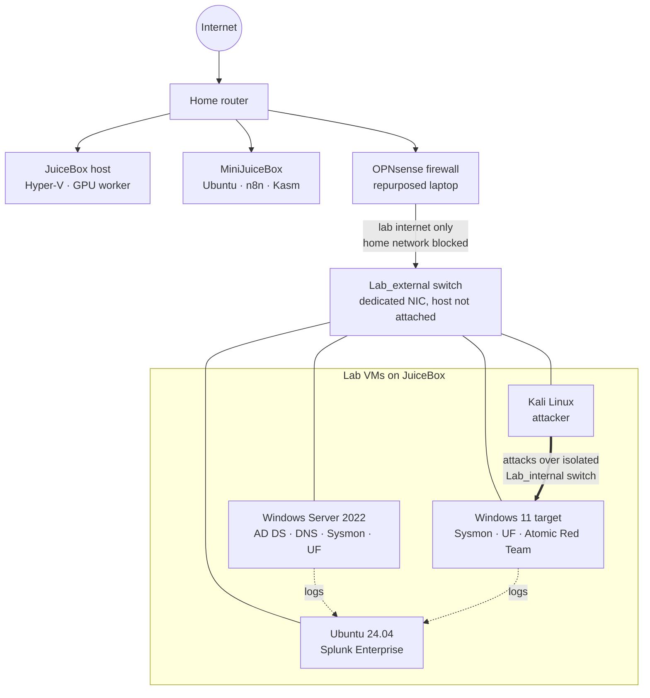
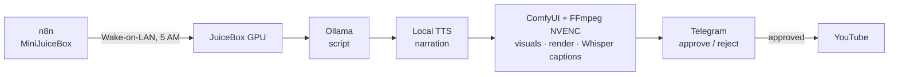

# Hey, I'm Yossef Habib 👋

**InfoSec intern at a regional government agency** · BS in Cybersecurity · CompTIA Security+

Day to day I work alert triage, incident response, and endpoint policy on the InfoSec team of a regional government agency. During my free time I build and break **JuiceBox**, a home detection lab with Active Directory, a SIEM, an attacker VM and its own firewall, so I can run real ATT&CK techniques and see exactly what the telemetry looks like.

---

## 🛡️ What I Do

- **SOC operations:** Cortex XDR alert triage, XSOAR phishing investigations, and incident response in a CJIS-compliant environment co-managed with Palo Alto Unit 42
- **Endpoint control:** Primary ThreatLocker administrator for my organization (application allowlisting, policy management)
- **Detection engineering (homelab):** Simulating MITRE ATT&CK techniques and building Splunk detections from Sysmon and Windows Security logs
- **Network segmentation:** Lab traffic isolated from my home network behind a dedicated OPNsense firewall, with Hyper-V port ACLs as a second layer
- **Automation:** A self-hosted, local-AI video pipeline built with n8n, Ollama and Claude Code

---

## 🧪 Homelab: JuiceBox

A Hyper-V detection lab on a Ryzen 7 7800X3D / 32 GB / RTX 5070 host, supported by an always-on Linux server and a repurposed laptop running OPNsense.

**What's in it**
- **Active Directory domain** on Windows Server 2022 with a domain-joined Windows 11 endpoint
- **Telemetry:** Sysmon (Olaf Hartong config) + Splunk Universal Forwarder → Splunk Enterprise
- **Attack simulation:** Kali Linux and Atomic Red Team; first exercise is RDP brute force (**T1110**)
- **Two networks per VM:** an internal-only switch for attack traffic and logs, and an external switch that reaches the internet *only* through OPNsense
- **Segmentation:** OPNsense blocks the lab from the household network, Hyper-V extended port ACLs back it up, and the host blocks all inbound traffic from the lab
- **Host hardening:** least-privilege service accounts, firewall rules scoped to a single source host, versioned firewall-state backups, Smart App Control enforcing

**Currently working on**
- [ ] Getting Splunk back to a clean license state, then the first SPL detection + SOC dashboard for T1110
- [ ] Shipping OPNsense firewall logs into Splunk
- [ ] Next: SOAR/EDR layer (Wazuh + Shuffle or LimaCharlie + Tines)

---

## 🤖 Side Project: JuiceBot, a Local AI Content Pipeline

A self-hosted pipeline that turns each day's top cybersecurity story into a narrated, animated YouTube Short, running on my own hardware with local models.

- **Runs unattended:** n8n cold-boots the GPU box with Wake-on-LAN every morning; services start with nobody logged in
- **Human in the loop:** nothing publishes until I approve it from my phone
- **Built like production:** each service runs under its own non-admin account, LAN ports are scoped to the orchestrator only, and remote access goes through a Cloudflare Tunnel + Zero Trust with no ports forwarded
- **Built with Claude Code** as my coding agent, with a written boundary between what it owns (pipeline code and docs) and what I own (lab architecture)

---

## 📜 Certifications

- **CompTIA Security+ (SY0-701)** · February 2026
- **BS, Cybersecurity** · Metropolitan State University · May 2026

---

## 🧰 Tools

### SIEM, Detection & Response

  
  
  
  
  
  

### Network & Firewall

  
  
  
  
  
  

### Virtualization & Infrastructure

  
  
  
  
  

### Automation & AI

  
  
  
  
  
  

### Scripting & OS

  
  
  
  
  
  
  

---

## 📂 Projects

### Completed

| Project | Description |
|---------|-------------|
| [JuiceBot: AI Content Creator Agent](https://github.com/yossefhabib/JuiceBot-AI) | A self-hosted AI pipeline that turns each day's top cybersecurity story into a narrated, animated YouTube Short using local models. Hardened with per-service accounts, LAN ports scoped to a single host, no forwarded ports, and a human approval gate from my phone. Built with Claude Code. |
| OPNsense Lab Firewall *(write-up coming)* | Turned an old gaming laptop into a dedicated OPNsense firewall that gives lab VMs internet access while blocking them from the home network. Includes a persistent fix for a flapping USB NIC on FreeBSD and a Hyper-V switch moved onto its own adapter. |
| [Mac Mini Ubuntu Kasm Server](https://github.com/yossefhabib/MiniJuiceBox) | Repurposed a T2 Intel Mac Mini into a 24/7 headless Ubuntu server running Kasm Workspaces and n8n, reachable from anywhere through Cloudflare Tunnel + Zero Trust with zero ports forwarded. |
| [Setting up Splunk](https://github.com/yossefhabib/Splunk) | Deployed Splunk on Ubuntu to centralize logs from Windows Server 2022 and Windows 11 via the Universal Forwarder, with Sysmon telemetry for threat detection and AD monitoring. |
| [Setting up Active Directory DS](https://github.com/yossefhabib/Initial-AD-setup-) | Built an Active Directory domain from scratch on Windows Server, joined a Windows 11 client, and created groups and users. |
| [Subnet Configuration & ICMP Validation](https://github.com/yossefhabib/Netconfig) | Built an isolated Hyper-V network with static IPv4 across Windows and Linux VMs, validated connectivity, and adjusted firewall rules as groundwork for AD and the SIEM. |
| [Hyper-V Kali Linux VM Setup](https://github.com/yossefhabib/HyperVSetUp) | Deployed an isolated Kali Linux VM on Hyper-V with network segmentation, resource tuning, and image integrity verification for AD attack simulation. |
| [Homelab Host Build](https://github.com/yossefhabib/HomelabWorkstationBuild) | Designed, assembled and validated the Windows 11 Pro workstation that hosts the multi-VM lab and the GPU workloads. |

### In Progress

| Project | Description |
|---------|-------------|
| T1110 Detection Lab | RDP brute force from Kali against the Windows 11 target, confirming 4625/4624 events land in Splunk, then the first SPL detection and a SOC dashboard. |
| Firewall Logs → SIEM | Forwarding OPNsense firewall logs into Splunk as a second detection data source. |

### Planned

| Project | Description |
|---------|-------------|
| SOAR Automation | Wazuh + Shuffle for automated incident-response playbooks |
| EDR Integration | LimaCharlie + Tines for endpoint detection and response |
| CSI Linux VM | OSINT and digital-forensics workstation inside the lab |
| Offline Knowledge Server | A local, offline reference library and AI assistant (Project NOMAD) |

---

📫 Open to conversations about SOC work, detection engineering, and homelabs. Reach me on [LinkedIn](https://www.linkedin.com/in/yossef-habib/).

